<div align="center">

<h1>c-tuikit</h1>

<p><b>Terminal panels for C tools, and their command line twins.</b></p>

<picture>
  <source media="(prefers-color-scheme: light)" srcset="docs/screens/gallery-light.gif">
  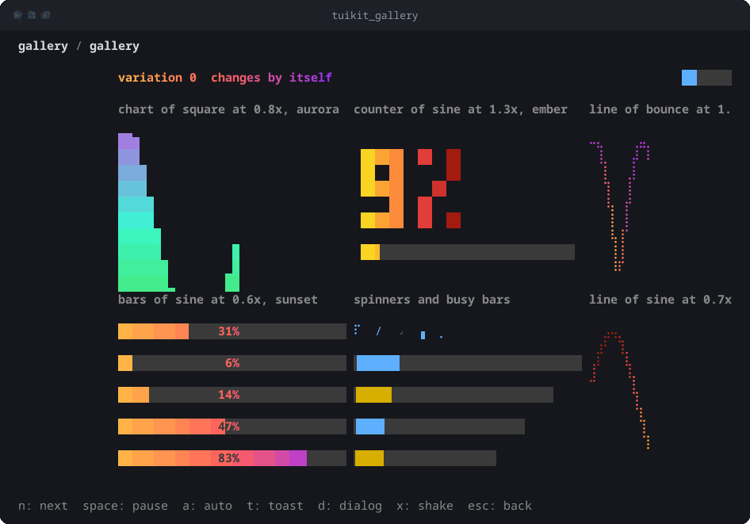
</picture>

<p>
<a href="#a-tour">Tour</a> ·
<a href="#build-and-install">Build</a> ·
<a href="#usage">Usage</a> ·
<a href="#components">Components</a> ·
<a href="#testing-a-tool">Testing</a> ·
<a href="docs/api.md">API</a> ·
<a href="CHANGELOG.md">Changelog</a>
</p>

</div>

Instead of printing a numbered menu and reading a number in a loop, a tool built on c-tuikit shows
a screen: what is going on right now, the actions it can take, and the outcome of each one. The
same actions are subcommands when there is no terminal, so the tool works in scripts and pipes
without a second code path.

C99, threads and nothing else. Linux, macOS and the Windows console (Windows 10 or later).

Every moving picture on this page is a real session of a program in [`examples/`](examples),
recorded with `TUIKIT_RECORD` on a dark and on a light background.

## A tour

<table>
<tr>
<td width="50%" valign="top">
<picture>
  <source media="(prefers-color-scheme: light)" srcset="docs/screens/deploy-light.gif">
  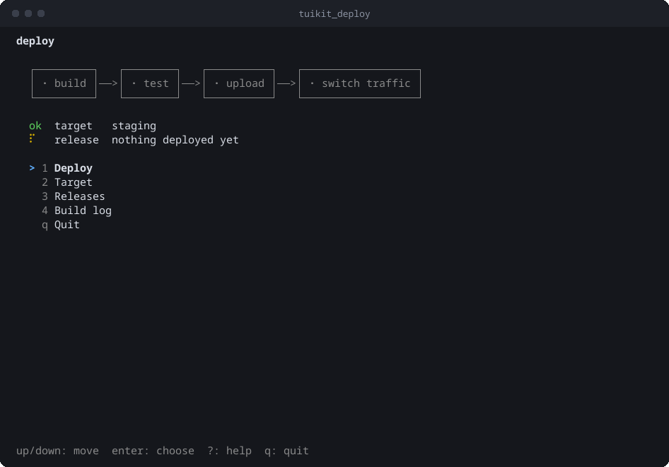
</picture>
<p><b><a href="examples/deploy.c">deploy.c</a></b>: a small tool built the way a real one would be.
Its pipeline is the banner, a dialog asks before it starts, and the work runs on a thread with
progress, a log and esc to cancel.</p>
</td>
<td width="50%" valign="top">
<picture>
  <source media="(prefers-color-scheme: light)" srcset="docs/screens/dashboard-light.gif">
  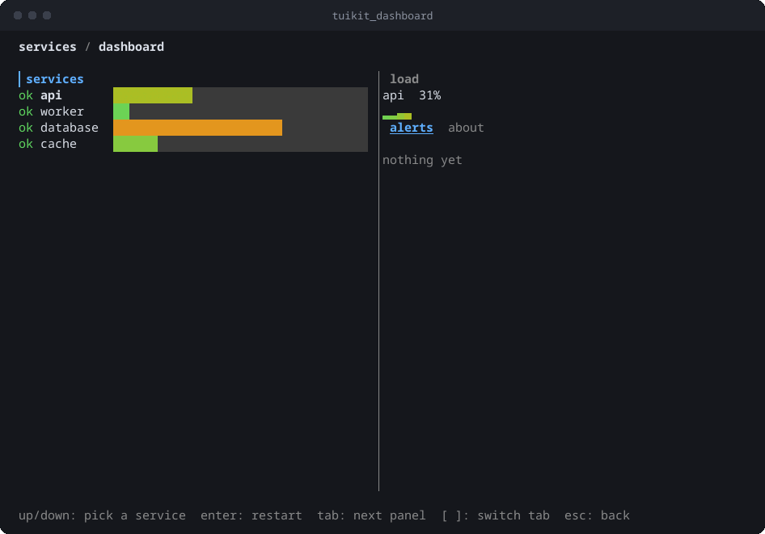
</picture>
<p><b><a href="examples/dashboard.c">dashboard.c</a></b>: a screen made of panels and tabs. Tab
moves the focus, <code>[</code> and <code>]</code> switch tabs, and the bars shift from green to
red as the load rises.</p>
</td>
</tr>
<tr>
<td width="50%" valign="top">
<picture>
  <source media="(prefers-color-scheme: light)" srcset="docs/screens/csv-light.gif">
  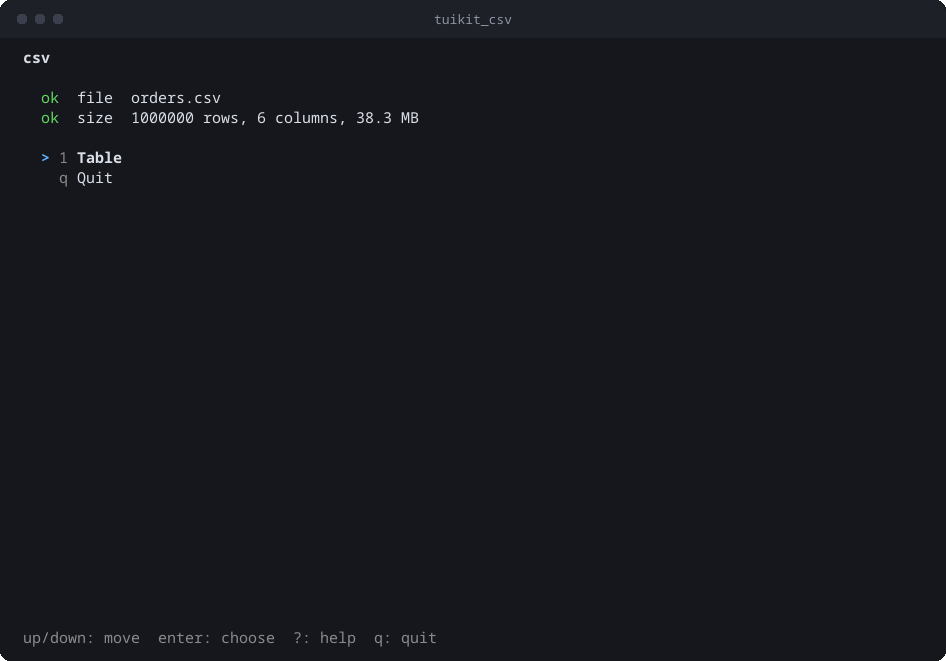
</picture>
<p><b><a href="examples/csv.c">csv.c</a></b>: a CSV file of a million rows opened as a table.
Sorting and filtering run on a worker thread, so keys never wait for them.</p>
</td>
<td width="50%" valign="top">
<picture>
  <source media="(prefers-color-scheme: light)" srcset="docs/screens/tail-light.gif">
  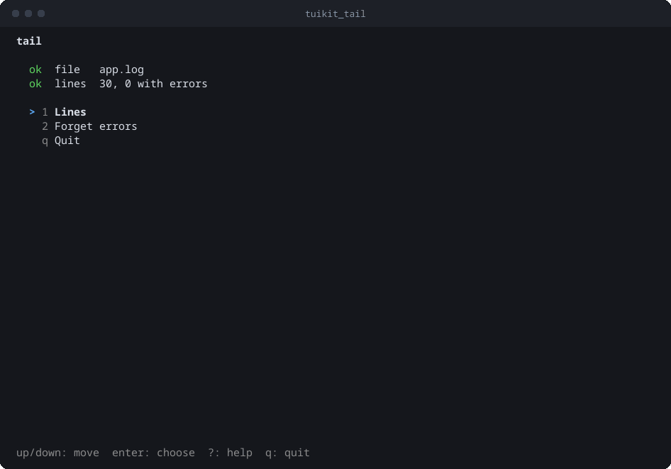
</picture>
<p><b><a href="examples/tail.c">tail.c</a></b>: a file read on a timer into a live log. It
follows the end, pauses while you scroll and counts the errors in a status line.</p>
</td>
</tr>
<tr>
<td width="50%" valign="top">
<picture>
  <source media="(prefers-color-scheme: light)" srcset="docs/screens/form-light.gif">
  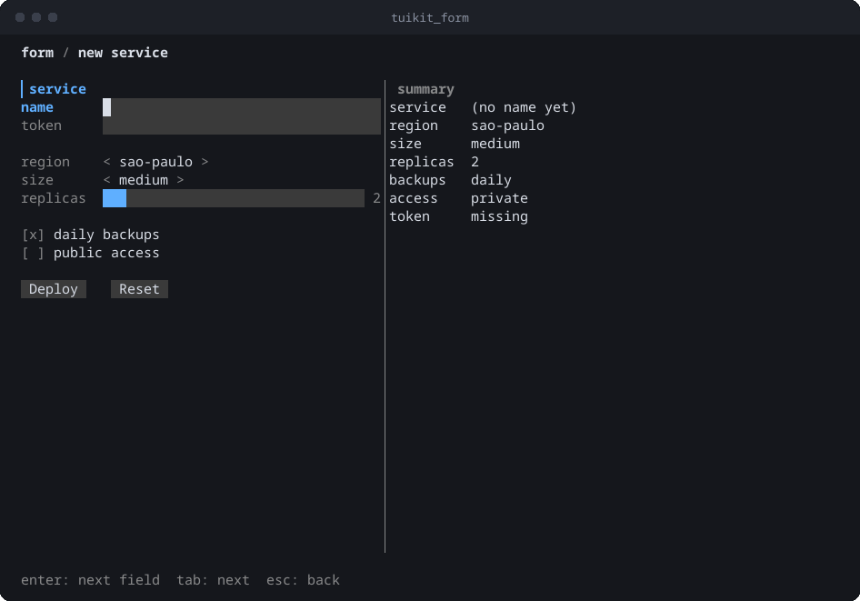
</picture>
<p><b><a href="examples/form.c">form.c</a></b>: a form with a live summary. Text, secrets,
choices, a slider and checkboxes, with a callback on every change.</p>
</td>
<td width="50%" valign="top">
<picture>
  <source media="(prefers-color-scheme: light)" srcset="docs/screens/monitor-light.gif">
  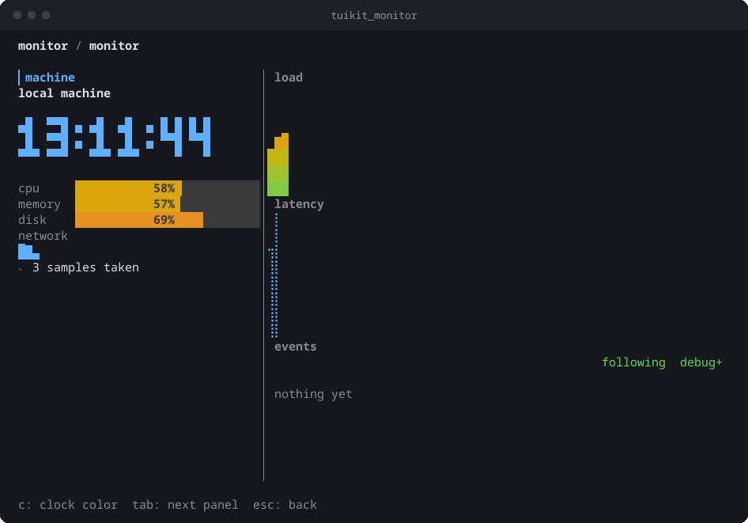
</picture>
<p><b><a href="examples/monitor.c">monitor.c</a></b>: a screen made only of components, with a
clock in big letters written from scratch as a component of its own.</p>
</td>
</tr>
</table>

[`examples/basic.c`](examples/basic.c) is a tour of every feature and
[`examples/gallery.c`](examples/gallery.c), at the top of this page, keeps making up new
combinations of charts, bars, spinners and motion. [`examples/README.md`](examples/README.md)
says which one to start from.

## What it does

**Panels**

- status lines with a mark (`ok`, `..`, `!!`), a label and a value, refreshed on a timer while the
  panel waits for a key; a value that changes is highlighted for a moment
- values that live outside the status callback (`pnl_value_t`), set from any thread; the panel
  wakes up and redraws only what changed
- actions chosen with the arrow keys (or `j`/`k`) and enter, by number, by first letter, or by
  name with `:`; `?` lists the keys of the current screen
- an action may leave a result, open a live screen of its own, or hand the terminal back
  (`pnl_app_with_terminal`) to print or start other programs
- screens split into panels side by side, stacked or in tabs (`pnl_layout_*`); panels and table
  columns marked optional fold away when the terminal gets narrow
- dialogs drawn over the current screen (`pnl_view_push_dialog`) and short notifications in the
  corner that go away on their own (`pnl_toast`)

**Work and data**

- slow work runs on a thread with progress, a log and esc to cancel (`pnl_task_run`)
- ready-made screens: confirmation, text input, filterable pick list, pager with search and a
  table you can sort and filter; each one degrades to plain stdin and stdout on the command line
- tables of millions of rows read from a callback (`pnl_table_source`), sorted and filtered on a
  thread without blocking keys
- a live log fed from any thread (`pnl_log_*`): follows the end, pauses while you scroll, filters
  by level and by text
- optional memory between runs (`pnl_app_set_memory`): the last action, the last item picked,
  input history and the filter and order of each table
- a bell and a desktop notification when a long task ends while you are in another window
  (`pnl_notify`; `TUIKIT_NOTIFY=bell` or `off`)

**Look**

- colors by role (accent, ok, warn, fail, muted...) fitted to the terminal: true color, 256 or
  16 colors, light or dark background, `NO_COLOR`; themes built in or from a file
- charts for the canvas: bars (with the percentage inside if you like), sparklines, column
  charts several rows tall, labeled columns side by side and line plots drawn with braille dots;
  each one can shift from green to red as the value rises
- waiting indicators: five spinners (`pnl_canvas_spinner`: dots, line, arc, blocks, bounce) and
  a bar that sweeps back and forth when there is no end to measure (`pnl_canvas_busy`)
- big letters in two sizes, banners and art that follows the work: a diagram of steps that
  tracks a running task and pictures that change with the state of the tool
- a frame clock for small animations: spinners, smooth bars, a fading highlight on values that
  change; optional sliding selection, screen transitions, entrances, feedback and numbers that
  count up to their new value (`TUIKIT_MOTION=all`). Animations never hold back a key and turn
  off with `TUIKIT_MOTION=off` or on their own over a slow SSH link

**Input and tooling**

- keys the user can remap in `~/.config/tuikit/keys` or per tool (`ctrl-n = down`, `q = none`),
  or from code with `pnl_app_bind`
- the mouse works too: click an action, a row, a table header, a panel or a tab; the wheel
  scrolls. `TUIKIT_MOUSE=off` leaves the mouse to the terminal
- web addresses anywhere on screen become clickable links (OSC 8); `pnl_canvas_link` links any
  text, `TUIKIT_LINKS=off` turns them off
- f12 opens the inspector, an X-ray of the running program: frame times with a sparkline, the
  stack of screens, how many actions, values, timers, watches and tasks are alive, and the last
  events; `TUIKIT_INSPECT=off` turns it off
- for everyone: `TUIKIT_LINEAR=on` turns the panel into plain lines a screen reader can follow,
  `TUIKIT_CONTRAST=high` pushes every color to a strong contrast, and every action works from the
  keyboard alone

## Build and install

```sh
cmake -S . -B build -DBUILD_SHARED_LIBS=ON
cmake --build build
cmake --install build --prefix /usr/local
```

Use it from CMake:

```cmake
find_package(c-tuikit REQUIRED)
target_link_libraries(app PRIVATE c-tuikit::c-tuikit)
```

Or with pkg-config:

```sh
cc app.c $(pkg-config --cflags --libs c-tuikit)
```

Add `-DC_TUIKIT_BUILD_EXAMPLES=ON` to build the programs on this page into `build/`.

### Single-file form

`scripts/amalgamate.sh` writes `dist/c-tuikit/c-tuikit.h`. Copy it into your project and, in exactly
one `.c` file:

```c
#define PNL_IMPLEMENTATION
#include "c-tuikit/c-tuikit.h"
```

Define `PNL_STATIC` as well to keep every function private to that file.

## Usage

```c
static void show_status(void *ctx, pnl_app_t *app)
{
    pnl_status_line(app, PNL_MARK_OK, "config", "file found");
}

static void start(void *ctx, pnl_app_t *app)
{
    pnl_result(app, PNL_MARK_OK, "service started");
}

pnl_app_t *app = NULL;
pnl_app_create("service", NULL, &app);
pnl_app_on_status(app, show_status, NULL);
pnl_app_set_refresh(app, 1000);
pnl_app_add_action(app, "Start", start, NULL);
pnl_app_run(app, argc, argv, &exit_code);
pnl_app_destroy(app);
return exit_code;
```

`pnl_status_line` works only inside the status callback; `pnl_value_set` works anywhere, from any
thread; `pnl_result` and `pnl_task_run` while the panel or a command runs.

### The same tool without a terminal

Without a command and with a terminal, `pnl_app_run` opens the panel; otherwise it prints the
status lines. Every action is a subcommand too, `--json` gives output a script can read, and
`--yes` answers the confirmations. Work given to `pnl_task_run` runs on a thread in the panel and
in the foreground on the command line, so the same function serves both.

<p align="center">
<picture>
  <source media="(prefers-color-scheme: light)" srcset="docs/screens/cli-light.png">
  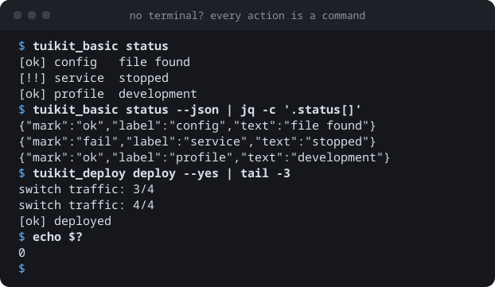
</picture>
</p>

### Keys

`?` lists the keys of the screen you are on and `:` runs any action by name. Both work on every
screen of every tool, and so does the mouse.

<p align="center">
<picture>
  <source media="(prefers-color-scheme: light)" srcset="docs/screens/keys-light.png">
  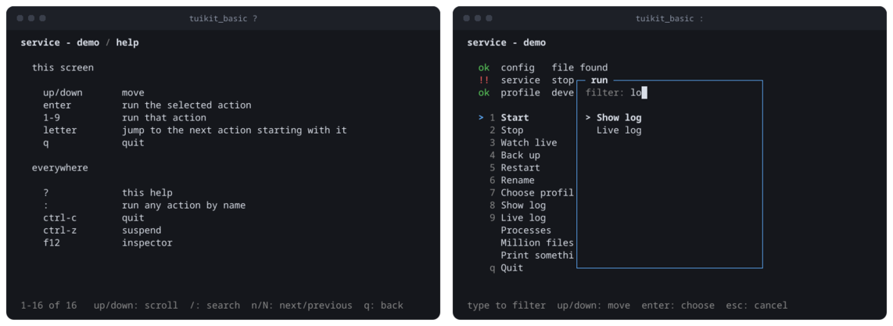
</picture>
</p>

## Components

A screen can be built from components instead of drawn by hand. Each one draws itself in the
space it gets, may take keys, may say how many rows it wants and which keys it answers to:

```c
pnl_widget_t *cpu, *load, *events, *side;
pnl_widget_bar(app, "cpu", PNL_METER_LEVEL | PNL_METER_PERCENT, &cpu);
pnl_widget_graph(app, "load", PNL_GRAPH_CHART, 0, PNL_METER_LEVEL, 300, &load);
pnl_widget_log(app, logbook, &events);
pnl_widget_stack(app, PNL_STACK_ROWS, &side);
pnl_widget_add(side, cpu, 0);
pnl_widget_add(side, load, 0);

pnl_layout_widget(layout, PNL_LAYOUT_ROOT, "machine", side, NULL);
pnl_layout_widget(layout, PNL_LAYOUT_ROOT, "events", events, NULL);

pnl_widget_set_value(cpu, 0.42);
pnl_widget_set_value(load, 42.0);
```

`pnl_widget_set_value` moves a bar (gliding with `PNL_MOTION_COUNT`) or adds a point to a graph;
`pnl_widget_set_text` changes text and labels. A component goes in a layout panel
(`pnl_layout_widget`), fills a screen of its own (`pnl_view_push_widget`), sits in a stack or is
drawn by another component (`pnl_widget_draw`). Tab, mouse clicks, the footer and `?` work the
same for every one of them.

A component of your own is a class of callbacks:

```c
static const pnl_widget_class_t clock_class = {clock_draw, clock_key, clock_height, clock_hints, NULL};
pnl_widget_create(app, &clock_class, &clock_state, &clock);
```

Only `draw_fn` is required. `height_fn` returns the rows it wants for a width (0 to take what is
left), `hints_fn` the keys for the footer, and `release_fn` runs on `pnl_widget_destroy`.
Components are changed from the panel's own thread (actions, timers, keys) and must outlive the
screens that show them. See [`examples/monitor.c`](examples/monitor.c), with a clock made from
scratch.

### Layouts that fold

Panels and table columns marked optional give way when the terminal gets narrow. The same
dashboard at 96 and at 48 columns:

<p align="center">
<picture>
  <source media="(prefers-color-scheme: light)" srcset="docs/screens/responsive-light.png">
  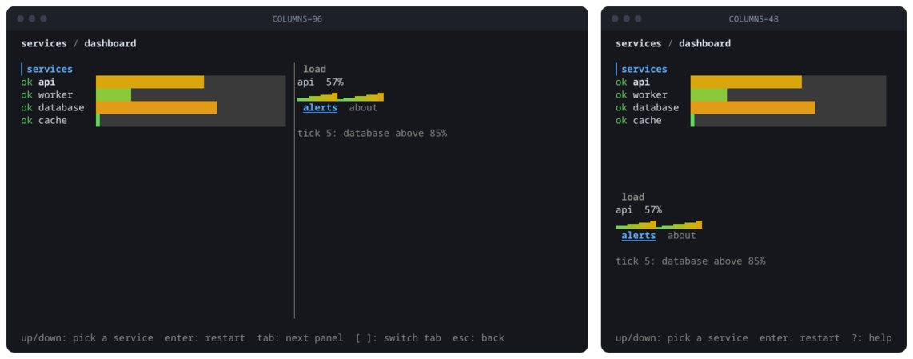
</picture>
</p>

### Forms

Text fields, checkboxes, choices, sliders and buttons are components that take the focus. Put
them in a stack and tab, shift-tab, enter and up/down move between them; a click focuses one;
when the last one is passed, tab goes on to the next panel:

```c
pnl_widget_input(app, "name  ", 0, &name);
pnl_widget_input(app, "token ", PNL_INPUT_SECRET, &token);
pnl_widget_choice(app, "region", regions, 4, &region);
pnl_widget_slider(app, "copies", 1, 12, 1, &copies);
pnl_widget_check(app, "daily backups", 1, &backups);
pnl_widget_button(app, "Deploy", deploy, &form, &button);

pnl_widget_on_change(name, describe, &form);
pnl_widget_get_text(name);
pnl_widget_get_value(copies, &value);
pnl_widget_focus(fields, name);
```

`pnl_widget_get_text` gives what a field holds (or the option chosen) and `pnl_widget_get_value`
the number behind it: the slider position, the index of the choice, 1 or 0 for a checkbox.
`pnl_widget_set_text` and `pnl_widget_set_value` fill them from code without calling the change
callback. While a text field has the focus every key is typed into it, even `q` and `?`; esc
still goes back. A component of your own joins the tab order with `pnl_widget_set_focusable`
and draws itself highlighted when `pnl_canvas_focused` says so.

## Colors and themes

Parts of the screen ask for a role, never for a color, and the role is fitted to the terminal
and its background. Four themes come built in, and `TUIKIT_THEME=~/.config/mytool/theme.txt`
loads one from a file:

<p align="center">
<picture>
  <source media="(prefers-color-scheme: light)" srcset="docs/screens/themes-light.png">
  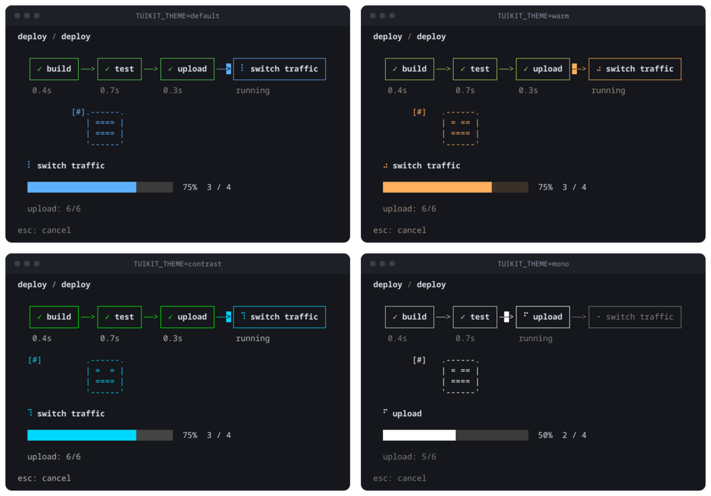
</picture>
</p>

When a part needs a color of its own, register it once and use it like any other:

```c
int orange, sunset;
static const unsigned long stops[] = {0xffb347, 0xff5e62, 0x9b2fff};

pnl_app_color(app, 0xff8800, &orange);
pnl_app_gradient(app, stops, 3, 12, &sunset);

pnl_canvas_text(canvas, 0, 0, PNL_FG(orange), "orange text");
pnl_canvas_gradient_text(canvas, 0, 1, PNL_BOLD, sunset, "a title in sunset colors");
pnl_canvas_gradient_fill(canvas, 0, 2, 40, 1, sunset);
pnl_canvas_bar(canvas, 0, 3, 40, 0.7, PNL_METER_GRADIENT(sunset) | PNL_METER_PERCENT);
pnl_widget_graph(app, "load", PNL_GRAPH_CHART, 6, PNL_METER_GRADIENT(sunset), 200, &load);
```

A gradient runs through two or more stops in 2 to 24 steps; `pnl_gradient_color` gives the
color at any point between 0 and 1. `PNL_METER_GRADIENT` paints bars along their length and
charts, sparklines and plots by height. Colors are sent as they are in true color and fitted to
the nearest one on 256 and 16 color terminals; with `NO_COLOR` they are left out. There is room
for about fifty of them (a gradient takes one per step); past that the call returns
`PNL_ERR_LIMIT`.

## Big letters and art

The main screen can open with the tool's own banner: art of your own, or the name of the tool in
big letters when `art` is `NULL`. A gradient colors it from left to right:

```c
pnl_app_set_banner(app, NULL, sunset);
pnl_app_set_banner(app, "┌───────┐   ┌──────┐   ┌────────┐\n"
                        "│ build ├──>│ test ├──>│ deploy │\n"
                        "└───────┘   └──────┘   └────────┘", 0);
```

The banner shows only when the status lines and every action still fit below it, and never in
linear mode. Big letters come from a 3 by 5 pixel font drawn with blocks: `PNL_BIG_SMALL` is three
rows tall, `PNL_BIG_LARGE` five rows with wider letters. It has the digits, the letters (lower
case is drawn as upper case) and the usual signs (`. , : ; - + = _ % / ! ? ( ) < > * # ' " $ @ |`):

```c
pnl_canvas_big(canvas, 0, 0, PNL_BIG_LARGE, PNL_FG(PNL_ROLE_OK), 0, "99.9%");
pnl_big_width(PNL_BIG_LARGE, "99.9%");
pnl_widget_big(app, "12:45", PNL_BIG_SMALL, 0, sunset, &clock);
pnl_widget_art(app, logo, PNL_FG(PNL_ROLE_MUTED), 0, &picture);
```

### Art that follows the work

Two components turn art into part of the interface, drawn from what the tool is doing:

- `pnl_widget_flow` is a diagram of steps in boxes joined by arrows. Each step is waiting,
  running, ok, failed or skipped; a running step spins and the arrow into it moves. A worker
  thread can call `pnl_widget_set_step` directly. When the boxes do not fit across, the flow
  turns into a list going down
- `pnl_widget_scene` holds one picture per state, each with one or more frames separated by
  `\f`. `pnl_widget_set_value(scene, state)` switches the picture; frames play at `frame_ms`

```c
pnl_widget_flow(app, &flow);
pnl_widget_add_step(flow, "build", NULL);
pnl_widget_add_step(flow, "test", NULL);
pnl_widget_scene(app, &scene);
pnl_widget_add_scene(scene, RUNNING, "[#]   |==|\f   [#]|==|", PNL_FG(PNL_ROLE_ACCENT), 0, 180);
pnl_widget_add_scene(scene, FAILED, "[#] x |??|", PNL_FG(PNL_ROLE_FAIL), 0, 0);

pnl_app_set_banner_widget(app, flow);
pnl_task_show(task, stage);
pnl_widget_set_step(flow, 1, PNL_STEP_FAIL, "2 failed");
pnl_widget_set_value(scene, FAILED);
```

`pnl_app_set_banner_widget` puts any component where the banner goes, so the main screen shows
how the last run went. `pnl_task_show` draws a component above the step, progress and log of a
running task. The state numbers belong to the tool; the library only matches them. In linear
mode scenes are left out and a flow is read as a list. The deploy example in the tour opens with
its pipeline as a live banner and shows a package travelling to the server while it deploys.

## Testing a tool

A panel runs without a terminal too. `pnl_test_create` starts it on a virtual screen with a
virtual clock; `pnl_test_keys` types a script of keys and waits until the screen settles, and
`pnl_test_expect` compares the screen with a snapshot file:

```c
pnl_test_t *test = NULL;
pnl_test_create(app, 60, 20, &test);
pnl_test_keys(test, "down enter \"release-1.2\" enter");
pnl_test_wait(test, 2000);
if (pnl_test_expect(test, "tests/snapshots/release.txt") != PNL_OK)
    return 1;
pnl_test_destroy(test);
```

A different screen is saved next to the snapshot as `.new` and the call returns
`PNL_ERR_MISMATCH`. A missing snapshot is never created on its own, so a wrong path fails in CI:
the screen goes to `.new` and the call returns `PNL_ERR_NOT_FOUND`. Run once with
`TUIKIT_SNAPSHOTS=update` to write new snapshots or rewrite changed ones.
Timers and toasts follow the virtual clock, so the same script gives the same screen.

The keys of one script are queued together, so `"enter esc"` opens a task and cancels it while
it runs. The call returns once the screen is still and every task and table sort has finished.
Besides key names and quoted text, a script takes `click:X,Y` (a click at that column and row)
and `wheelup` / `wheeldown`.

`TUIKIT_RECORD=demo.cast tool` records a session as an asciicast file, ready for
`asciinema play` or for turning into a GIF, which is how the pictures on this page were made;
`pnl_app_record(app, path)` does the same from code, and under test it records the scripted
session with the virtual clock.

`bench/run.sh` measures drawing, rendering, logs, values, a table of a million rows and the
memory each part takes.

## Conventions

- every function that can fail returns `PNL_OK` or an error code; `pnl_strerror` describes it
- what `pnl_x_create` returns is released only by `pnl_x_destroy`, which accepts `NULL`
- functions never take ownership of their arguments; returned pointers belong to the library
- pass a `pnl_allocator_t` to `pnl_app_create`, or `NULL` for `malloc`/`free`
- `PNL_ERR_NOMEM` means an allocation failed; `PNL_ERR_LIMIT` means a fixed limit was reached
  (key bindings, custom colors, watched descriptors, steps of a flow, pictures of a scene)
- components and callbacks run on the panel's thread, with these exceptions made to be called
  from anywhere: `pnl_value_set*`, `pnl_log_write`, `pnl_task_*` inside the work function,
  `pnl_task_show`, `pnl_widget_set_step` and `pnl_widget_set_value` on a scene
- the `cell_fn` of `pnl_table_source` is called from the panel's thread and, for tables of more
  than 20 000 rows, also from a worker thread at the same time while sorting or filtering. It
  must only read data that stays the same while the table is open and write into the `buf` it
  is given, never into shared or static memory

## Documentation

- [docs/api.md](docs/api.md): every function, type and macro of `include/c-tuikit/c-tuikit.h`
- [docs/threads.md](docs/threads.md): what runs on which thread and what may be called from
  other threads
- [docs/stability.md](docs/stability.md): what a release promises about the API, the ABI and
  the files a user writes

## Versioning

Semantic Versioning. Compatible releases bump the minor version; incompatible ones bump the
major version and the soname. Since 1.0.0 the API and the ABI of the shared library hold within a
major version: CI compares every build against the baseline in `abi/`. A function on its way out
is marked deprecated for at least one minor release before the next major removes it. See
[docs/stability.md](docs/stability.md) and [CHANGELOG.md](CHANGELOG.md).

## License

MIT, see [LICENSE](LICENSE), [NOTICE](NOTICE) and [AUTHORS](AUTHORS).
